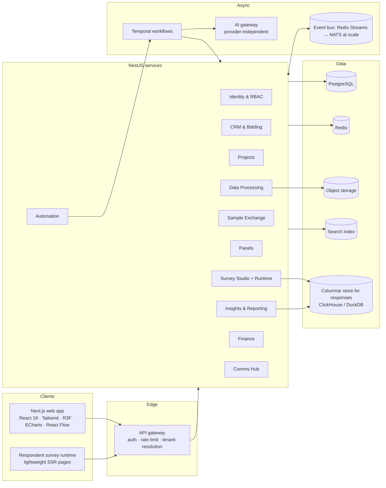
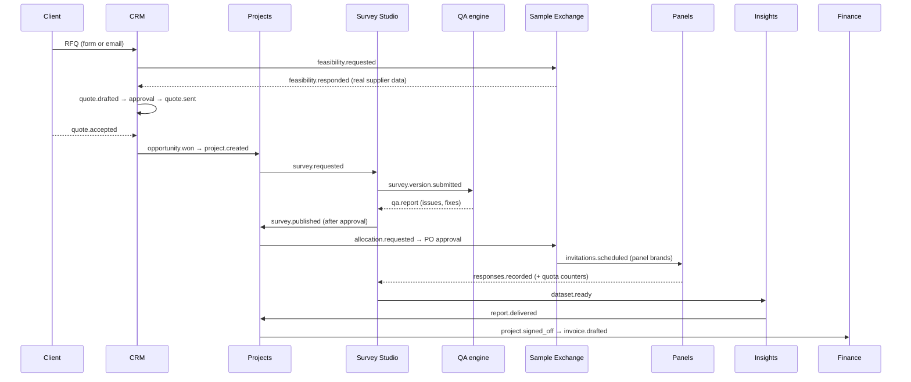

# Sampledge AI Research OS: architecture

Status: Phases 1–4 implemented (web, API, database, shared domain package, workflow worker). Items marked *planned* are Phase 5+. The diagram shows the target system; Phase 4 runs the event bus as a Postgres outbox rather than Redis/Temporal (see §4).

## 1. System overview

**Principle: one shared project record.** CRM, Projects, Survey Studio, the Sample Exchange, Panels, Analytics and Finance all reference `Project.id`. Modules never copy project fields; they subscribe to domain events and read through APIs. The Phase 2 store already behaves this way: moving a CRM deal to *Won* creates the project that Projects, the Command Center globe and the ops flow immediately show.

## 2. Module communication

Events carry ids, not denormalised copies, and every handler is idempotent (a PO is unique per allocation; an invoice is skipped if the project already has one).

**Implemented in Phase 4** (`apps/api/src/common/events.ts`, `apps/api/src/modules/worker.ts`):

| Event | Emitted by | Worker effect |
|---|---|---|
| `opportunity.won` | CRM stage → Won | notify PMs |
| `feasibility.requested` / `.responded` | CRM request / vendor answer | vendor email / notify Business Development |
| `quote.sent` | quote approval | client email |
| `approval.requested` / `.decided` | any approval | notify deciders / requester |
| `allocation.approved` | purchase approval | PO + payable + vendor pending balance + vendor email + finance notification |
| `project.stage_changed` | project stage | at *Invoice*: draft invoice + finance notification |
| `invoice.issued` | finance | client email |
| `payable.paid` | payment approval | vendor email |
| `survey.published`, `quota.filled` | publish approval, runtime | notifications |
| `message.queued` | Comms Hub send or high-volume approval | delivery through the adapter |

## 3. Frontend architecture (implemented)

| Concern | Choice | Where |
|---|---|---|
| App framework | Next.js 15 App Router, React 19, TypeScript strict | `apps/web/src/app` |
| Styling | Tailwind 3 mapped to CSS-variable tokens; dark/light/system | `src/app/globals.css`, `tailwind.config.ts` |
| Motion | Motion for React (layout, page transitions, counters); CSS for loops | `components/ui`, `components/shell` |
| 3D | React Three Fiber + Drei, lazy-loaded, paused offscreen, 2D fallbacks | `components/three` |
| Charts | Apache ECharts, lazy-loaded, theme-aware wrapper | `components/charts/echart.tsx` |
| Node editors | React Flow (`@xyflow/react`) | `components/survey/logic-builder.tsx`, `components/flow/workflow-editor.tsx` |
| State | Zustand store hydrated from the API; offline fallback persists to localStorage | `apps/web/src/lib/store.ts`, `apps/web/src/lib/api.ts` |
| Survey runtime | Pure TS engine, deterministic, unit-tested; same code runs in the API | `packages/core/src/survey/engine.ts` |
| Access | Role matrix drives nav and UI redaction; the API enforces the same matrix | `packages/core/src/roles.ts` |

GSAP was listed as optional; Motion covers every animation in Phase 2, so GSAP is not installed. shadcn/ui is not used as a dependency; the component library follows the same headless + Tailwind pattern with Sampledge tokens.

## 4. Backend architecture

### Implemented in Phases 3–5
- **Monorepo** (npm workspaces): `packages/core` (survey engine, roles and permissions, pricing, analytics, demo seed) is compiled once and imported by both `apps/api` and `apps/web`, so routing, quota rules, the role matrix and CPI estimates cannot drift between client and server.
- **NestJS modular monolith** (`apps/api`): projects, commercial (clients, opportunities, quotes), vendors, surveys, respondent runtime, panels, approvals and ops (agents, notifications, audit, dashboard). Compiled with `tsc` (decorator metadata).
- **PostgreSQL + Prisma** (`apps/api/prisma/schema.prisma`, four migrations). Every business row carries `tenantId`.
- **Transactions** wherever two records must change together: Won → project; approval decision → its effect; survey version → quota-cell upsert; completion → quota increments + project completes.
- **Atomic quotas**: `UPDATE "QuotaCell" SET count = count + 1 WHERE id = $1 AND (hard = false OR count < target)` inside the completion transaction; zero rows updated means the cell filled first, so the completion rolls back and the respondent is overquota. Tested with four concurrent respondents racing for one slot.
- **Transactional outbox** (Phase 4): `emit(tx, …)` writes an `OutboxEvent` in the caller's transaction, so side effects happen only for committed changes. The worker claims a batch with `FOR UPDATE SKIP LOCKED` and a 30 s lease (safe with several workers), handles each event in its own transaction, retries up to 5 times and keeps `lastError`. It runs in the API process by default; set `WORKER_INLINE=false` and run `node dist/worker.js` to separate it. `/health` reports `outboxPending`.
- **Delivery adapter** (Phase 4): every outbound message is a `Message` row; the only adapter is *development* (status `delivered_dev`, nothing sent). Email/SMS providers implement the same `deliver()` in Phase 6.
- **AI gateway** (Phase 5, `apps/api/src/ai`): each task is `{name, version, system, render, schema (zod), rules}`. `AiGateway.run` uses the rules unless `AI_PROVIDER=anthropic` and a key are set; then it calls Claude (`claude-opus-5-5`, server-side fallback models enabled, structured JSON output), parses and schema-checks the result, and falls back to the rules on refusal, invalid output, error or the tenant's monthly cap. Every call writes an `AiCall` row (tokens, cost, status). Document text extraction (docx via mammoth, xlsx via exceljs, PDF via unpdf) checks file signatures and size first.
- **Results and reports** (Phase 5): `surveyResults` and `qualityFlags` live in `packages/core` and run on recorded responses; the API builds PowerPoint files with pptxgenjs from the same result object. Quality flags are computed inside the completion transaction.
- **Research methods** (Phase 5): `packages/core/src/methods.ts` is import-free so the same MaxDiff, conjoint, pricing and TURF code runs in the browser, the API and the unit tests.
- **Web ↔ API**: Next rewrites `/api/v1/*` to the API, keeping the session cookie first-party. The Zustand store hydrates from the API after sign-in and turns each action into an API call (optimistic update, reload on error). If the API is unreachable the app falls back to the labelled offline demo.

### Planned
- **Broker or Temporal** only if volume or long-running timers call for it; the outbox claim query is the swap point.
- **WebSocket fan-out** for live counters (Phase 6).
- **Columnar analytics store** for responses at volume (Phase 6).
- **AI evaluation set** run against the live provider before enabling it per tenant; per-agent caps; tool-calling agents behind the approval gate (Phase 6).
- **Object storage** for uploads and exports with content-type validation and scanning (Phase 6).
- **Observability**: OpenTelemetry traces, structured logs, metrics (Phase 6).

## 5. Security model

**Enforced today (application layer):**
- Sessions: bcrypt password hashes; the JWT holds only a session id, checked against the `Session` table on every request, so logout and revocation take effect immediately. httpOnly, SameSite=Lax cookie (`COOKIE_SECURE=true` behind HTTPS). Optional TOTP MFA. Sign-in rate limit per IP, counted in Postgres so it holds across API instances. Unknown emails and wrong passwords return the same error after a constant-cost hash compare.
- A global guard resolves the session, then checks the role's module access from `packages/core/src/roles.ts` (writes need `full`) and the route's permission keys. Services add tenant scoping and ownership for scoped roles (vendor → own vendor; client → own client).
- Redaction happens in the API: roles without `view:margins` never receive cost or margin fields; roles without `view:vendor_bids` never receive other vendors' rate cards, payables or allocation CPIs.
- The human-approval gate is server-side: consequential actions create an `Approval`; only a role with that kind's permission, other than the requester, can decide; the effect runs in the same transaction as the decision.
- Every mutation writes an `AuditLog` row with actor, before and after.
- Integration tests prove cross-tenant reads return 404 and scoped roles cannot widen their view.

**Planned:** Postgres row-level security as a second isolation layer (Phase 6), SSO, per-user notification state, secrets management, security headers review and a penetration test.

- Healthcare data in a separate encrypted schema; matching uses eligibility flags. Today the panelist table holds only pseudonymous handles and banded demographics.
- No compliance certification is claimed. GDPR and health-privacy obligations are design inputs, to be verified.

## 6. Performance budget

- 3D scenes: lazy chunk, `dpr ≤ 1.75`, frameloop paused offscreen, auto-rotate off under reduced motion, WebGL detection with 2D fallback.
- Charts: dynamic import of ECharts; one instance per panel; resize observer.
- Dense screens (tables, kanban, QA report) have no continuous animation.
