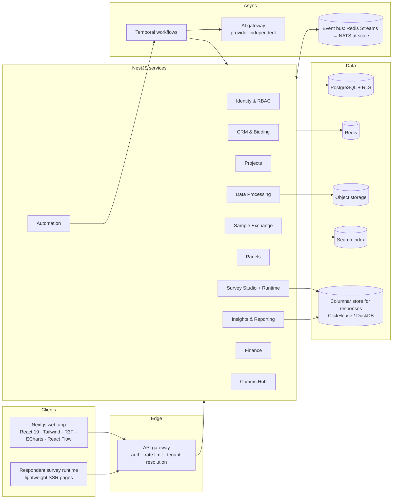
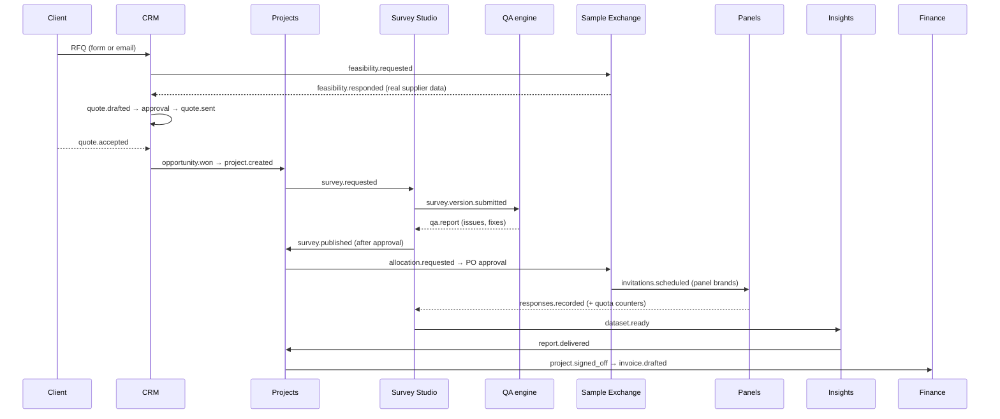

# Sampledge AI Research OS: architecture

Status: Phase 1 design, Phase 2 prototype implemented. Backend described here is the target for Phase 3+.

## 1. System overview

**Principle: one shared project record.** CRM, Projects, Survey Studio, the Sample Exchange, Panels, Analytics and Finance all reference `Project.id`. Modules never copy project fields; they subscribe to domain events and read through APIs. The Phase 2 store already behaves this way: moving a CRM deal to *Won* creates the project that Projects, the Command Center globe and the ops flow immediately show.

## 2. Module communication

Events are versioned (`project.created.v1`) and carry ids, not denormalised copies. Every consumer is idempotent; Temporal owns anything long-running or needing retries and human approval.

## 3. Frontend architecture (implemented)

| Concern | Choice | Where |
|---|---|---|
| App framework | Next.js 15 App Router, React 19, TypeScript strict | `src/app` |
| Styling | Tailwind 3 mapped to CSS-variable tokens; dark/light/system | `src/app/globals.css`, `tailwind.config.ts` |
| Motion | Motion for React (layout, page transitions, counters); CSS for loops | `components/ui`, `components/shell` |
| 3D | React Three Fiber + Drei, lazy-loaded, paused offscreen, 2D fallbacks | `components/three` |
| Charts | Apache ECharts, lazy-loaded, theme-aware wrapper | `components/charts/echart.tsx` |
| Node editors | React Flow (`@xyflow/react`) | `components/survey/logic-builder.tsx`, `components/flow/workflow-editor.tsx` |
| State | Zustand store persisted to localStorage (stands in for the API) | `src/lib/store.ts` |
| Survey runtime | Pure TS engine, deterministic, unit-tested | `src/lib/survey/engine.ts` |
| Access | Role matrix drives nav, guards, redaction | `src/lib/roles.ts` |

GSAP was listed as optional; Motion covers every animation in Phase 2, so GSAP is not installed. shadcn/ui is not used as a dependency; the component library follows the same headless + Tailwind pattern with Sampledge tokens.

## 4. Backend architecture (Phase 3 target)

- **NestJS modular monolith first**, one Nest module per domain, split into services only where load demands it (survey runtime and response ingestion first).
- **PostgreSQL + Prisma** (`prisma/schema.prisma`). Tenant isolation by `tenantId` + row-level security policies; isolation tests in CI.
- **Responses** land in Postgres for transactional quota counting (row lock or Redis atomic counters with periodic reconciliation), then stream to a columnar store for analytics.
- **Redis**: sessions, rate limiting, quota counters, WebSocket fan-out.
- **Temporal**: RFQ → feasibility → quote approval, PO approval, invitation scheduling, report generation, agent runs with retries and human-approval signals.
- **AI gateway**: provider-independent interface (`complete`, `structured`, `toolCall`), prompt registry with versions, eval suite, per-tenant and per-agent cost caps, usage metering, approval checkpoints. Phase 2's rule-based assistant uses the same "tool" functions the gateway will call.
- **Object storage**: questionnaire uploads, datasets, exports; virus scan + content-type validation on upload.
- **Observability**: OpenTelemetry traces, structured logs, Prometheus metrics, health checks per service.

## 5. Security model

- Role matrix (`docs/ROLE_MATRIX.md`) + permission keys enforced by Nest guards and RLS.
- External roles are scoped: vendor users see only their own bids/allocations; client users never see `cpiCostCents`, margins or supplier agreements; panelists see nothing internal.
- Healthcare data in a separate encrypted schema; matching uses eligibility flags.
- Audit log on every mutation (Phase 2 already records an in-session audit trail).
- No compliance certification is claimed. GDPR and health-privacy obligations are design inputs, to be verified.

## 6. Performance budget

- 3D scenes: lazy chunk, `dpr ≤ 1.75`, frameloop paused offscreen, auto-rotate off under reduced motion, WebGL detection with 2D fallback.
- Charts: dynamic import of ECharts; one instance per panel; resize observer.
- Dense screens (tables, kanban, QA report) have no continuous animation.
